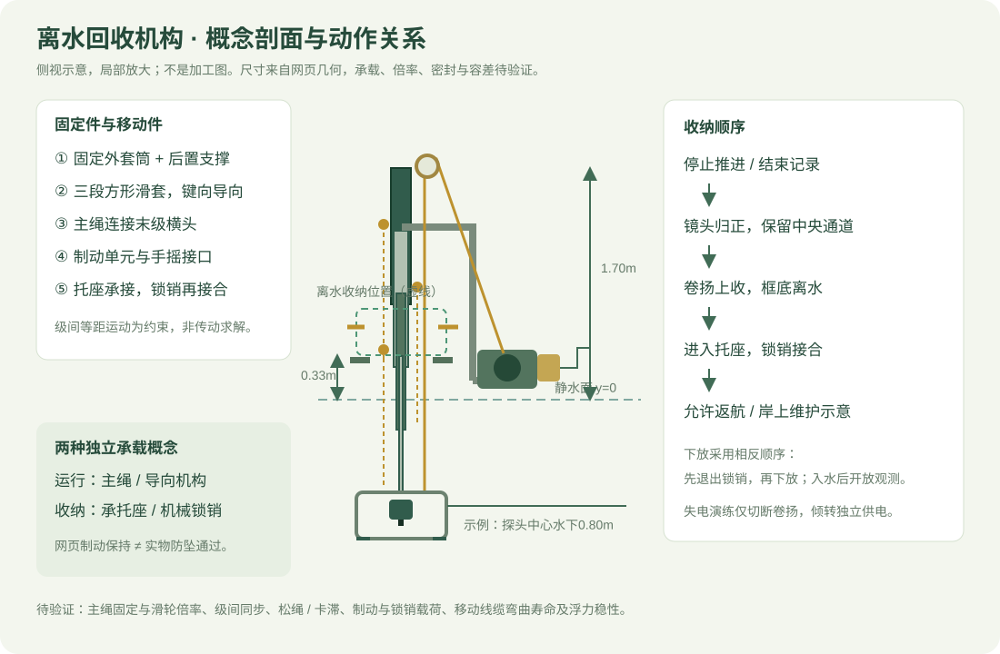

# 参衡 · 模型尺寸与工程待验证项

本文件描述 v0.4 网页概念。**模型尺寸不是实机定型参数；没有可供校核的实测重量、材料、浮筒排水曲线或结构试验。**

## 已落实到模型的关系

| 项目 | 模型设定 / 来源 | 能说明什么 |
|---|---|---|
| 船体外廓 | 宽约1.99m、长约2.61m，页面从浮筒几何包围盒计算 | 仅为造型尺寸，不含拆开的维护件、线缆或检视标记 |
| 观测头工作中心深度 | 水下0.30–1.90m | 网页工作行程 |
| 收纳中心位置 | 水面上0.55m | 保护框底部在静水面上0.33m；不是波浪中的保证净空 |
| 总演示行程 | 2.45m | 从水下1.90m至离水0.55m |
| 导向 | 四段方形套筒，各长1.00m；固定外套筒顶高1.70m | 方形表达抗相对转动意图；刚度、间隙和磨损未计算 |
| 最大伸出时的几何重叠 | 约0.173m | 仅证明套筒几何仍重叠，不证明能承受载荷 |
| 回收通道 | 前横梁中央留空、支撑移至后方 | 避免原横梁穿过护框路径；全构型干涉与容差仍待CAD校核 |
| 框 / 镜头 | 前下横杆留中央开口，镜头0–55°前倾 | 摄像视角可体验，碰撞保护能力和成像质量未验证 |
| 灯间距 | 可在0.36–0.60m间调节 | 比较布置，不预测后向散射或给出最优值 |

固定桅架升高是为了在保持套筒长度和重叠的同时完成离水回收。这会改变结构载荷与重心，必须随重量表重新校核，不应把此版本解释为已经优化过稳性。

## 传动方案的完成边界

主绳从卷扬经顶部导轮连接末级横头；级间滑套使用等距运动约束，附示意同步绳与滑轮。卷筒角位移按主绳收放行程联动。移动线缆显示侧面余量环，尚未指定拖链、滑环或分级布线件。

尚未求解：滑轮倍率、各段绳端固定、同步绳张力、松绳与卡滞、摩擦、导向承载、制动器选型、锁销剪切与托座载荷。**示意绳路不可直接用于加工。**

失电演练只切断卷扬驱动，模型保持高度并禁用推进；手摇恢复采用较慢的演示行程。倾转仍按独立供电演示，不代表全船断电时能电动归正。整船失电、绳断、制动失效、探头卡住的救援仍需另行设计。

## 必须建立的重量表

| 部件 | 质量 | 重心位置 | 下一步依据 |
|---|---|---|---|
| 浮筒 / 横梁 / 支撑 | 待定 | 待定 | 材料、壁厚、CAD与称重 |
| 电池 / 控制箱 / 线缆 | 待选型 | 待布置 | 实际选型与称重 |
| 卷扬 / 导向 / 制动 / 锁销 | 待定 | 随机构确定 | 受力与选型 |
| 镜头 / 灯 / 护框 / 传感器 | 待选型 | 随下放深度变化 | 空中重量与水中视重 |
| 紧固件 / 密封 / 备用浮力 | 待定 | 待定 | 完整装配清单 |

不填估测总重、续航或稳性结论。完成重量表和浮筒排水量后，再求工作 / 收纳姿态的重心、吃水、纵横倾及剩余浮力。

## 可复核的实物试验顺序

1. **机构台架：** 空载与代表载荷下循环下放、归正、回收、落座、锁止；记录位置、拉力、卡滞和磨损。先完成受力设计再确定试验载荷。
2. **故障台架：** 独立检查卷扬失电、制动、人工回收、锁销及松绳检测；网页保持不作为任何防坠证据。
3. **静水浮力与稳性：** 用实际整机重量，分别测试收纳和下放状态的吃水、倾斜与回正；不得从水平渲染图推断稳定。
4. **浑水槽成像：** 保持目标、距离和浑浊条件一致，对照灯距与角度，记录眩光、后向散射、视场遮挡及可辨目标。45点射线采样不能替代图像试验。
5. **推进维护：** 比较护网安装前后的推力 / 电流，检查模拟杂物与清理操作；不能由格栅外形推断防缠绕有效。
6. **数量可核验样区：** 在已知数量、包含遮挡的样区中，以原始视频与独立人工标注核对漏检、重复与复测收益。

可参考的原始设备资料：[Blue Robotics 推进器使用指南](https://bluerobotics.com/learn/thruster-usage-guide/)、[SubC 后向散射说明](https://support.subcimaging.com/guide-to-subsea-photography/Published/what-is-backscatter)。这些资料支持风险和试验方向，不构成本机验证报告。
