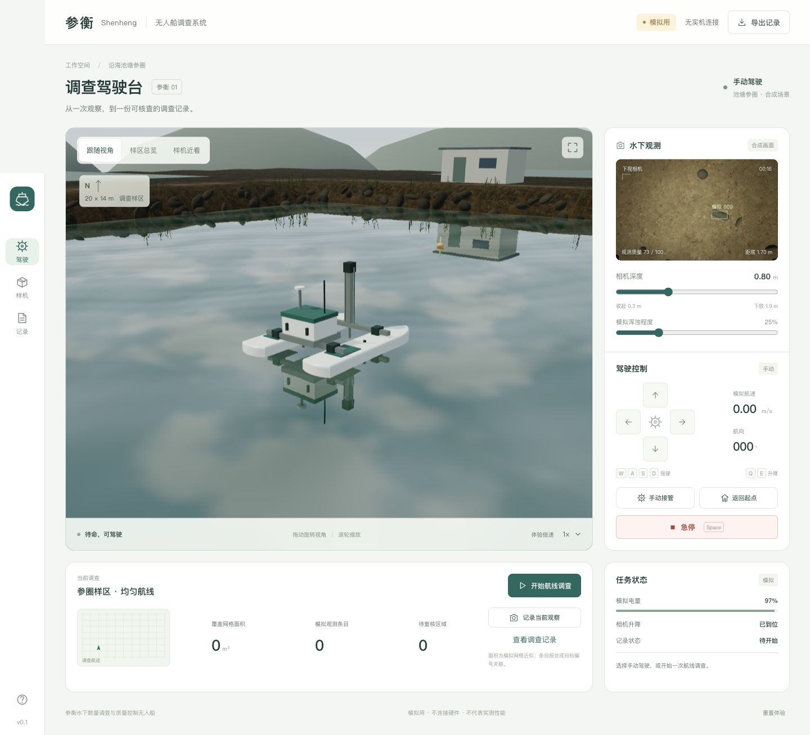
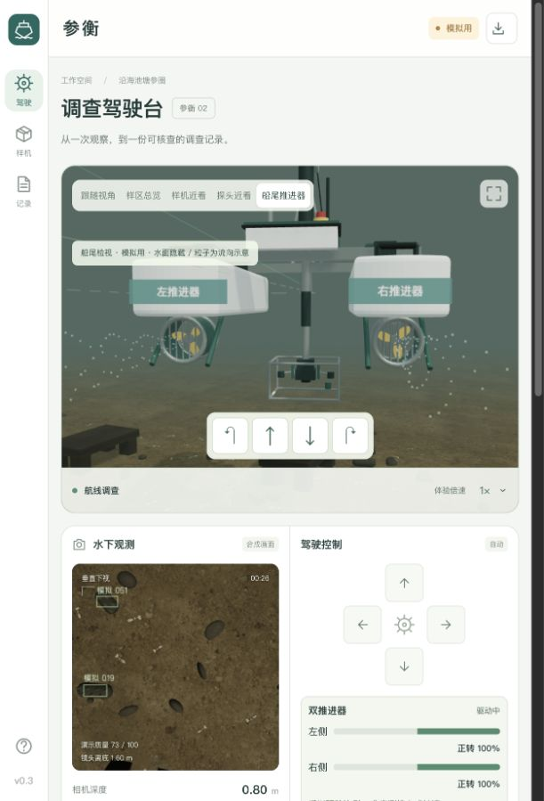
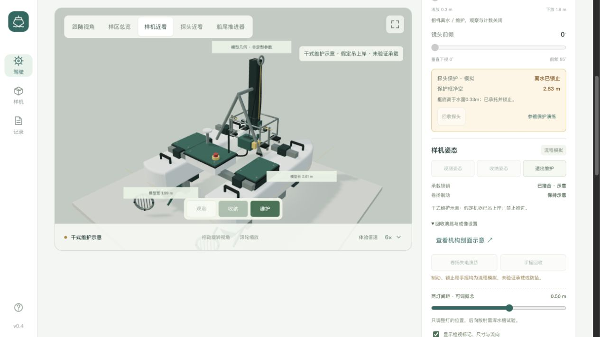

# 参衡 · 调查驾驶台

海参养殖调查双体无人船的网页交互原型。**模拟用，不连接真实机器。**

[打开驾驶模拟台](https://yun999-ccc.github.io/shenheng-driving-simulator/)



## 如何体验

- 拖动查看三维样机，滚轮缩放，切换跟随、总览和近看视角。
- W/A/S/D 或屏幕方向按钮驾驶；Q/E 或深度滑杆升降相机；前倾滑杆改变真实合成视场。
- 点击“开始航线调查”执行预设均匀航线，可选择体验倍速。
- 空格或“急停”停止运动，必须显式解除；手动接管会清除自动航线。探头净空保护触发时先回收，返航也先收探头再前进。
- 记录当前观察、查看记录并导出带有 SIMULATED_ONLY 标识的 CSV。

## 本地运行

无需安装 npm 依赖。需要支持 WebGL 2、ES modules 和 import maps 的现代浏览器。

```sh
python3 -m http.server 8080 --bind 127.0.0.1
```

打开 http://127.0.0.1:8080/ 。不要直接双击 HTML 文件运行。Three.js 和表面纹理已随项目提供，运行时无需第三方 CDN、API 密钥或账号登录。

```sh
node tests.mjs
```

状态模型包含46项检查，覆盖驾驶、升降、急停、接管、边界、航线完成、返航、合成观测关联和参礁遮挡。这些检查不是实机性能验证。

## 文件结构

- index.html / style.css：中文界面和响应式布局。
- simulation.mjs：简化运动学、任务状态与模拟记录。
- scene.js：程序化样机、视角和下视画面。
- environment.js：带反射与细波纹的池塘水面、坡岸、水闸和泥沙底质。
- habitat.mjs：参礁布局和简化的合成视线遮挡规则。
- app.js：输入处理、界面同步与 CSV 导出。
- vendor/：固定版本 Three.js 0.186.1 及其 MIT 许可。

## 数据与验证边界

位置、速度、深度、电量、画面、目标和质量分数均为模拟。目标按合成世界已知编号关联，未运行真实海参识别算法。质量分数不等于检出概率；网格面积为近似值。尚未完成浮力、水动力、防水、续航或实机测试。刷新或关闭网页后记录不保留，需要保留时先导出。

## 发布

GitHub Pages 从 main 分支根目录发布，.nojekyll 关闭 Jekyll 处理。所有资源使用相对路径，兼容仓库子路径。

## 来源与许可

依赖与技能来源见 [THIRD_PARTY_NOTICES.txt](THIRD_PARTY_NOTICES.txt) 和 [Three.js 许可证](vendor/THREE-LICENSE.txt)。本项目未额外授予原创代码的开源再利用许可；公开仓库用于查看源码与展示交互原型。

## 参圈场景参考

场景是参考沿海池塘养殖结构制作的合成环境，不是某个真实养殖场的测绘复刻。20×14米是可驾驶调查样区，不代表整个池塘面积。堤岸和换水设施围护池塘，浮标只标记调查区域，不表示防逃围网。

- 大连海洋大学研究中的泥沙底、方砖垒礁和潮汐换水池塘：[原文](https://xuebao.dlou.edu.cn/article/2017/2095-1388/201706010.html)。
- 多种海参养殖方式的说明：[原文](https://xuebao.dlou.edu.cn/article/2015/2095-1388/201502017.html)。
- 泥沙、泥土和岩石纹理由 Poly Haven 提供，许可 CC0；来源见 assets/textures/sources.json。它们是材质素材，并非该模拟池塘的现场照片。

水波、反射、浑浊、补光与参礁遮挡都是视觉和几何近似；没有验证真实水动力、光传播或识别精度。屋顶遮挡规则只针对合成参礁，不构成完整的视觉检测器。

## 参虾混养情景

日本对虾（车虾）参考密度2尾/平方米，20×14米样区固定生成560尾模拟虾；模型为约10厘米的演示外观，不代表初放虾苗或预计成活数量。依据及限制见 [SHRIMP-RESEARCH.md](SHRIMP-RESEARCH.md)。页面“显示混养虾”控制视觉对照，虾不进入海参数量记录。

这一功能用来体验混养场景下的观察，不计算营养、水质或利润改善。虾模型采用共享几何与实例渲染，运动由模拟时间驱动，刷新或重置后可复现。

## 参衡02机构与保护交互

外观增加低位电池舱、低矮控制舱、四节固定长度伸缩导向、倾转观测头、保护框、分置补光、测距概念模块、可拆推进器护罩、检修盖和回收提手。详见 [MACHINE-REVISION.md](MACHINE-REVISION.md)。

- “探头近看”隐藏水面作为结构检视，不代表水面能看穿池塘。
- 净空由已知参礁几何近似计算，达到0.20米演示阈值时停驶并锁定下放；可点击“回收探头”。这个数值不是实机安全标准。
- “参礁保护演练”清空本次记录并载入合成礁区。下放至1.9米触发保护，再回收；返航需先将探头离水收纳并锁止。
- 已扫过、有效网格、未核查网格和礁下待核查分开显示；未观测不按零海参处理。标记只表达合成可见性，不是统计上的总量估计。
- 相机倾转、画面和合成观察共用视场；CSV新增倾角、净空、保护状态和遮挡字段。

没有新增真实硬件连接；没有完成真实浮力、稳定性、结构强度、走线传动、密封、推力或视觉识别验证。双推进器仍不提供独立横移。33项状态检查通过不等于工程安全认证。

## 推进器交互 v0.3



[直接打开船尾检视](https://yun999-ccc.github.io/shenheng-driving-simulator/?v=thrusters-3&view=thruster)。按住画面内方向按钮或 W/S 观察正反转，A/D 观察差动；松开后停驱，船体仍可能短暂滑行。正常跟随视角保留不透明池塘水面。

- 三片独立桨叶、轮毂、导管和前后固定护网分别建模。金色桨叶便于与护网区分，未指定实际材料。
- `propulsion.mjs` 将前进/转向输入混合为归一化左右驱动，限制在 -1…1，采用0.16秒示意响应。左右均值驱动纵向运动，左右差值驱动转向；仍是简化运动学，没有质量、惯量、阻力或真实电机曲线。
- 侧栏比例条、桨叶动画、检视粒子和两侧水面扰流共用左右驱动状态；比例不是推力、功率、电流或 RPM。粒子仅在船尾检视显示，不是气泡生成或真实流体仿真。尾流不保存历史流场。
- 水下检视隐藏水面及岸上环境，并提高检视照明；这些处理只用于看清结构，不代表实际可见度。船尾镜头随船航向转动。
- 急停、探头保护和回收会清除左右驱动；解除后不会自动恢复旧命令。原有26项检查和新增7项推进检查共33项通过，不代表实机性能验证。

## v0.4 离水收纳与结构检查



[打开新版样机](https://yun999-ccc.github.io/shenheng-driving-simulator/?v=recovery-4&view=model)。画面内点击“收纳”：先归正、离水、落座、锁销接合；“观测”先解锁再下放；“维护”先收纳，然后进入假定吊上岸的干式维护示意。维护中禁止推进。

回收机构增加键向导向、主绳 / 级间示意、制动与手摇接口、线缆余量环及承托锁销。原横梁中央开通道。详细[机构剖面](assets/lift-concept.svg)、[当前实现与限制](MACHINE-REVISION.md)、[模型尺寸、重量表及试验清单](DESIGN-REVIEW.md)。

水下摄像保留实物部件网格，合成记录与标记按结构射线遮挡过滤；离水或维护时停止摄像观测与计数。灯距可调，45点射线采样只估计结构入镜，不计算实际散射。进阶设置可体验卷扬失电保持和手摇回收；仅卷扬失电，倾转按独立供电演示。CSV新增锁销状态。

当前46项状态检查通过，另检查桌面、390px布局及浏览器交互。全部为网页逻辑 / 几何验证，未完成真实重量、浮力、承载、传动倍率、防坠或成像验证。
